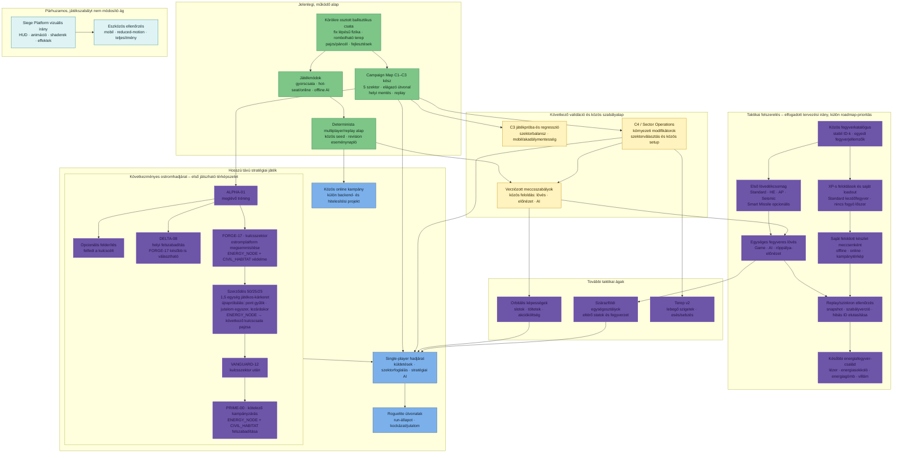

# Játékmenet-fejlesztési útvonal

Ez az ábra a jelenlegi játékmeneti alapot és a tervezett fejlesztési ágakat
mutatja, a fő függőségekkel. Nem dátumozott ütemterv és nem vállalt
végrehajtási sorrend: a központi státuszt a [roadmap](./roadmap.md), a részletes
progressziós és fegyvertervet a [gameplay-elemzés](./gameplay-progression.md)
és a [végrehajtási TODO](./gameplay-progression-todo.md) tartalmazza.

## A diagram olvasása

**2026-11-07: elfogadott következő gameplay-prioritás a következményes
ostromhadjárat Phase 1 MVP-je.** A diagramon a hosszú távú hadjárathoz
kapcsolódik, de ez a következő gameplay-próba: nem előfeltétele a teljes C4-,
fegyver-, orbitális vagy egységosztály-csomag. A rendszer a Campaign térképhez
tartozik, nem a sima offline módhoz. Az első térképszelet az `ALPHA-01`
tréningből, opcionális felderítésből és két megszállt célágból áll: a
`DELTA-08` helyi eredményt ad; a `FORGE-17` a felderítéssel felfedhető
kulcsszektor, amelynek felszabadítása nyitja meg a `VANGUARD-12`-t. A
felderítés kihagyható, és egyik célág teljesítése sem zárja el a másikat.
A módosított feloldás már működik: csak `FORGE-17` nyitja meg
`VANGUARD-12`-t, majd `PRIME-00` harci győzelme zárja a kampányt.
`FORGE-17` és `PRIME-00` egyaránt kötelező, védendő létesítményes szektor.
A régi C3 OR-útvonalon már teljesített szektorok megmaradnak a migráció során;
korábbi épületkárt nem állítunk elő ezekből.

`FORGE-17`-ben az ostromplatform a fő cél, az `ENERGY_NODE` és
`CIVIL_HABITAT` védendő szerződéses objektum; a 50/25/25 súlyok csak erre a
küldetésre vonatkoznak. A szerződéses kredit és XP a folyamatos pontszámmal
lineárisan skálázódik, míg a harci XP külön marad; a kredit Phase 1-ben csak
jelentés, elkölthető kampányegyenleg későbbi terv. A játékos okozta objektumkár
az 1,5 súlyozott egységű kampánykeretet fogyasztja, AI-kár nem csökkenti sem
a szerződést, sem ezt a keretet. Az `ENERGY_NODE` fizikai állapota — AI-kár
esetén is — a következő kulcscsata maximális pajzsát módosítja (+10/0/−10%).
Vereség, döntetlen vagy csataelhagyás nem szabadítja fel a szektort, de
elmenti az objektumállapotot és a játékos kárát. Az eredményképernyőn ilyenkor
csak előzetes szerződéspont látszik; az újrapróbálások kárai összeadódnak, a
szerződéses jutalom pedig csak a küldetés végleges lezárásakor, egyszer jár.
A kampányreset törli az új kampányadatokat, az XP-profilt és a fejlesztéseket
viszont megtartja.
**Fejlesztési állapot (2026-11-07):** az objektumállapot, a robbanási
sebzés, a játékoskár-követés és a pajzshatás tesztelt logikai alapja elkészült.
A jóváhagyott reaktor és civil kupolatelep már megjelenik a `FORGE-17` és `PRIME-00`
Campaign csatában, robbanásból sebződik, HP-ja és állapota a HUD-on is
látszik. A romok többé nem sebződnek; az épületek esési sebzés nélkül követik
a terepfelszínt. A kampánykár-mentés, szerződéselszámolás és pajzshatás
bekötése még hátravan; új csata jelenleg visszaállítja az objektumok HP-ját.
A pozíciókat új csatánként a meccs seedjéből, külön véletlenszámsorral
választjuk szektoronként öt, egymással és az induló tankokkal nem átfedő
helyből. Azonos seed azonos elrendezést ad; különböző seednél az elrendezés
ismétlődhet. A térkép fejléce alatt külön blokk magyarázza a kampány célját.
Előbb az ostromhelyzetet és a kampánykövetkezményt kell igazolni játékpróbával.
Részletes terv: [11. fejezet](./gameplay-progression.md#11-következményes-ostromhadjárat);
végrehajtás: [TODO, 6A](./gameplay-progression-todo.md#6a-következményes-ostromhadjárat--első-játszható-próba).

- **Zöld:** megvalósított alap. A Campaign Map C3 működik, de további
  játékpróba és eszközös ellenőrzés még szükséges.
- **Sárga:** következő validációs/közös szabályalap; a C4 és a verziózott
  konfiguráció részletes döntései még nyitottak.
- **Lila:** tervezett, még nem implementált bővítés. A fegyvereknél az
  implementáció és a központi roadmap-prioritás még nincs jóváhagyva; a
  következményes ostromhadjárat Phase 1 viszont elfogadott következő gameplay-próba.
- **Szürke:** hosszú távú stratégiai irány, külön specifikációt igényel.
- **Türkiz:** a gameplay-szabályoktól elkülöníthető vizuális és eszközminőségi
  munka.

A fegyvercsomagban minden fegyver saját alapkarakterisztikát kap; a játékos
Standard Shell-lel indul, további fegyvereket XP-ért old fel, és a saját
feloldott készletét viszi offline, online és kampánytérképes meccsre. A
Robbanófej upgrade ettől különálló marad. Fegyverenként külön XP-fejlesztési ág
nem része az első csomagnak; később csak új taktikai döntést adó fejlesztés
indokolt.
